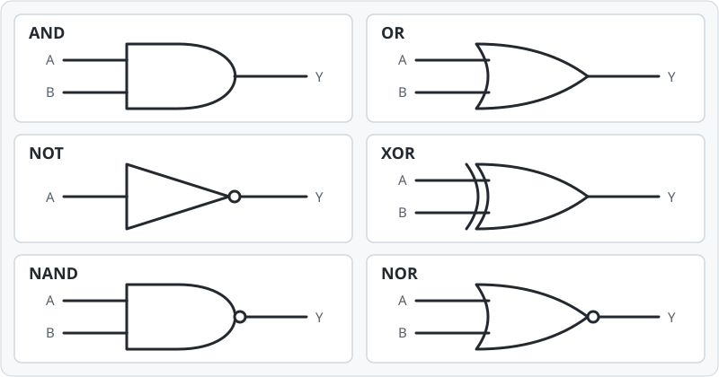

# COMP4009: Foundations of Computer Systems (Semester 1 2026-2027:1[OBO])

**Notes:**

## Read before Week 2

- https://research.ebsco.com/plink/016107f9-1bcd-39c4-878a-89bd1a3330e3
- https://r3-vlebooks-com.oxfordbrookes.idm.oclc.org/Reader?ean=9781473787346
- https://r4-vlebooks-com.oxfordbrookes.idm.oclc.org/EpubReader?ean=1780137909292

---

## Contents

1. [Numbering Systems: Why Binary?](#1-numbering-systems-why-binary)
2. [Lesson 1 Notes: Layers of a Computing System](#2-lesson-1-notes-layers-of-a-computing-system)
3. [Binary](#3-binary)
4. [Binary Conversion Method](#4-binary-conversion-method)
5. [Positional Number Formula](#5-positional-number-formula)
6. [Binary and Hexadecimal](#6-binary-and-hexadecimal)
7. [Binary and Octal](#7-binary-and-octal)
8. [Conversion from Decimal to Binary](#8-conversion-from-decimal-to-binary)
9. [Decimal to Octal](#9-decimal-to-octal)

---

## 1. Numbering Systems: Why Binary?

- Computers themselves understand binary at the hardware level.
- **Transistors:** At the hardware level, circuits are primarily built from transistors. Modern systems have billions of them.
- In digital circuits, electrical signals are interpreted as two logical states:
  - **0** = low voltage
  - **1** = high voltage
  - These states have defined voltage ranges.
- The physical world underlying a computer is **analog**.

---

## 2. Lesson 1 Notes: Layers of a Computing System

*In the order covered in the lesson:*

| Layer | Notes |
|---|---|
| **Communications** | Computers are connected to networks to share information and communicate with other computers (networks / internet). |
| **Applications** | Software developed to solve a specific issue or problem. |
| **Operating systems** | Help manage a computer's resources. |
| **Programming** | Software / instructions to manage and process data. |
| **Hardware** | The physical components of a computer system. |
| **Information** | How information is represented on a computer. Information is stored as binary numbers, using memory and on/off-type switches. |

---

## 3. Binary

**Topics:** Counting numbers, converting from binary to other number bases, and performing basic arithmetic operations in binary.

- The binary system is made up of **bits** (`0` or `1`: off or on).
- **8 bits = 1 byte.** A byte can represent **256 distinct values** (`0`–`255` when unsigned).

### Why binary?

- Computers use electronic devices to store and manipulate information.
- Computers interpret on/off information, which is represented using numbers (**binary digits**).
- Binary uses only **two symbols / digits**.
- To convert a binary number to its corresponding decimal form, multiply each digit by its corresponding power of **2**, then add the results.

---

## 4. Binary Conversion Method

- A number system is identified by its **base**.
- Decimal has **10 digits** (`0`–`9`); binary uses **base 2**.
- For each digit, calculate:

  **Digit × base^(digit position)**

- Count digit positions **from right to left**, beginning at **0**.

---

## 5. Positional Number Formula

For any positional number system:

**Digit value = digit × base^position**

Formula:

`dᵢ × bⁱ`

Where:

- `dᵢ` = the digit
- `b` = the number base
- `i` = the position of the digit, counting from `0` on the right

For a whole number:

`N = Σ(dᵢ × bⁱ)`

### Any numbering system

To work out the value, you need to know the **base** and the **position** of each digit.

### Example: `1011` (binary to decimal)

```text
(1 × 2³) + (0 × 2²) + (1 × 2¹) + (1 × 2⁰)

1 × 8 = 8
0 × 4 = 0
1 × 2 = 2
1 × 1 = 1

8 + 0 + 2 + 1 = 11
```

**Result:** `1011₂ = 11₁₀`

### How to convert a decimal number to binary

Use repeated division by **2** and read the remainders **from bottom to top**. See [Conversion from Decimal to Binary](#8-conversion-from-decimal-to-binary) for worked examples.

---

## 6. Binary and Hexadecimal

- **4 bits** can represent **16 distinct values** (`0`–`15`), matching the **16 hexadecimal symbols**.
- Hexadecimal is **base 16**.
- Its symbols are **`0`–`9` and `A`–`F`** (`A = 10` through `F = 15`).
- **1 byte = 2 hexadecimal digits = 2 nibbles.** One nibble (also spelled *nybble*) is **4 bits**.
- Hexadecimal is essentially a shorter, more human-readable representation of binary: grouping **4 bits** into **1 hexadecimal digit** makes long binary values easier to read.

### Example: `3F4` (hexadecimal to decimal)

`F = 15`, so:

```text
(3 × 16²) + (15 × 16¹) + (4 × 16⁰)
```

---

## 7. Binary and Octal

- **3 bits** can represent the **8 different octal symbols**.
- Octal is **base 8**, using digits **`0`–`7`**.
- For example, decimal `8` is octal `10`, and decimal `9` is octal `11`.

**Example octal number:** `3647₈`

---

## 8. Conversion from Decimal to Binary

**Method:** Repeatedly divide by **2** until the quotient is **0**, recording the remainder each time. Pass the quotient to the next stage. Read the remainders **vertically upward (bottom to top)** to get the binary value.

### Example 1: `10` to binary

```text
10 ÷ 2 = 5  remainder 0
 5 ÷ 2 = 2  remainder 1
 2 ÷ 2 = 1  remainder 0
 1 ÷ 2 = 0  remainder 1
                         ↑ Read upward
```

**Result:** `10₁₀ = 1010₂`

### Example 2: `25` to binary

```text
25 ÷ 2 = 12  remainder 1
12 ÷ 2 =  6  remainder 0
 6 ÷ 2 =  3  remainder 0
 3 ÷ 2 =  1  remainder 1
 1 ÷ 2 =  0  remainder 1
                          ↑ Read upward
```

**Result:** `25₁₀ = 11001₂`

### Example 3: `14` to binary

```text
14 ÷ 2 = 7  remainder 0
 7 ÷ 2 = 3  remainder 1
 3 ÷ 2 = 1  remainder 1
 1 ÷ 2 = 0  remainder 1
                         ↑ Read upward
```

**Result:** `14₁₀ = 1110₂`

---

## 9. Decimal to Octal

**Method:** Repeatedly divide by **8** until the quotient is **0**, keeping the remainder at each stage. Pass the quotient to the next stage. Read the remainders **from bottom to top**.

### Example: `25` to octal

```text
25 ÷ 8 = 3  remainder 1
 3 ÷ 8 = 0  remainder 3
                        ↑ Read upward
```

**Result:** `25₁₀ = 31₈`


-----
# Self Study

## Number Systems Introduction — Decimal, Binary, Octal & Hexadecimal

There are four main number systems we will work with:

| Number System   | Base | Digits Used |
| --------------- | ---: | ----------- |
| **Decimal**     |   10 | `0–9`       |
| **Binary**      |    2 | `0–1`       |
| **Octal**       |    8 | `0–7`       |
| **Hexadecimal** |   16 | `0–9, A–F`  |

---

## Decimal

**Decimal is Base 10.**

It is the number system we use for everyday counting.

```text
0 1 2 3 4 5 6 7 8 9
```

Example:

```text
348
```

---

## Binary

**Binary is Base 2.**

Binary is heavily used in computing because it only contains two possible digits:

```text
0 1
```

Example:

```text
101011100
```

---

## Octal

**Octal is Base 8.**

It uses the digits:

```text
0 1 2 3 4 5 6 7
```

There is no `8` or `9` in octal.

Example:

```text
534
```

---

## Hexadecimal

**Hexadecimal is Base 16.**

It uses:

```text
0 1 2 3 4 5 6 7 8 9 A B C D E F
```

The letters represent decimal values:

| Hex | Decimal |
| --- | ------: |
| A   |      10 |
| B   |      11 |
| C   |      12 |
| D   |      13 |
| E   |      14 |
| F   |      15 |

So:

```text
0123456789ABCDEF
```

---

# Converting Decimal to Binary / Octal / Hexadecimal

To convert a decimal number into another number system, we can use a technique called **successive division**.

The basic idea is:

1. Divide the decimal number by the **base** you want.
2. Record the **remainder**.
3. Divide the quotient again.
4. Keep going until the quotient becomes `0`.
5. Read the remainders **from bottom to top**.

```text
↑
Read
remainders
upwards
↑
```

The number you divide by depends on the destination:

| Conversion            | Divide By |
| --------------------- | --------: |
| Decimal → Binary      |         2 |
| Decimal → Octal       |         8 |
| Decimal → Hexadecimal |        16 |

---

# Decimal → Binary

## Example: Convert `348` to Binary

Because binary is **Base 2**, repeatedly divide by `2`.

```text
348 / 2 = 174 | R0
174 / 2 = 87  | R0
87  / 2 = 43  | R1
43  / 2 = 21  | R1
21  / 2 = 10  | R1
10  / 2 = 5   | R0
5   / 2 = 2   | R1
2   / 2 = 1   | R0
1   / 2 = 0   | R1
```

Now read the remainders **from bottom to top**:

```text
101011100
```

Therefore:

```text
348₁₀ = 101011100₂
```

or simply:

```text
348 = 101011100
```

---

# Decimal → Octal

## Example: Convert `348` to Octal

Because octal is **Base 8**, repeatedly divide by `8`.

```text
348 / 8 = 43 | R4
43  / 8 = 5  | R3
5   / 8 = 0  | R5
```

Read the remainders **from bottom to top**:

```text
534
```

Therefore:

```text
348₁₀ = 534₈
```

or:

```text
348 = 534
```

---

# Decimal → Hexadecimal

## Example: Convert `348` to Hexadecimal

Because hexadecimal is **Base 16**, repeatedly divide by `16`.

```text
348 / 16 = 21 | R12
21  / 16 = 1  | R5
1   / 16 = 0  | R1
```

Remember:

```text
12 = C
```

So the remainders are:

```text
C
5
1
```

Read them **from bottom to top**:

```text
15C
```

Therefore:

```text
348₁₀ = 15C₁₆
```

or:

```text
348 = 15C
```

---

# Converting Back to Decimal

When converting **to decimal**, we do not use successive division.

Instead, we use **place values / powers of the base**.

The general pattern is:

```text
digit × base^position
```

Positions start at `0` from the **right-hand side**.

Example positions:

```text
4 3 2 1 0
↓ ↓ ↓ ↓ ↓
1 0 1 1 0
```

---

# Binary → Decimal

Binary uses **Base 2**.

For example:

```text
10110101
```

Starting from the right:

```text
1 × 2^0
0 × 2^1
1 × 2^2
0 × 2^3
1 × 2^4
1 × 2^5
0 × 2^6
1 × 2^7
```

So:

```text
(1 × 2^7)
+ (0 × 2^6)
+ (1 × 2^5)
+ (1 × 2^4)
+ (0 × 2^3)
+ (1 × 2^2)
+ (0 × 2^1)
+ (1 × 2^0)
```

Calculate the values:

```text
128 + 0 + 32 + 16 + 0 + 4 + 0 + 1
```

```text
= 181
```

Therefore:

```text
10110101₂ = 181₁₀
```

---

# Octal → Decimal

Octal uses **Base 8**.

Example:

```text
534
```

Positions:

```text
2 1 0
↓ ↓ ↓
5 3 4
```

Calculate:

```text
(5 × 8^2)
+ (3 × 8^1)
+ (4 × 8^0)
```

```text
= (5 × 64)
+ (3 × 8)
+ (4 × 1)
```

```text
= 320 + 24 + 4
```

```text
= 348
```

Therefore:

```text
534₈ = 348₁₀
```

---

# Hexadecimal → Decimal

Hexadecimal uses **Base 16**.

Example:

```text
15C
```

Remember:

```text
C = 12
```

Positions:

```text
2 1 0
↓ ↓ ↓
1 5 C
```

Calculate:

```text
(1 × 16^2)
+ (5 × 16^1)
+ (12 × 16^0)
```

```text
= (1 × 256)
+ (5 × 16)
+ (12 × 1)
```

```text
= 256 + 80 + 12
```

```text
= 348
```

Therefore:

```text
15C₁₆ = 348₁₀
```

---

# Binary → Octal

Binary and octal have a useful shortcut.

Every **3 binary digits** correspond to **1 octal digit**.

Starting from the **right**, split the binary number into groups of 3.

Example:

```text
101011100
```

Split:

```text
101 | 011 | 100
```

Convert each group:

```text
101 = 5
011 = 3
100 = 4
```

Therefore:

```text
101011100₂ = 534₈
```

### Binary → Octal Table

| Binary | Octal |
| ------ | ----: |
| 000    |     0 |
| 001    |     1 |
| 010    |     2 |
| 011    |     3 |
| 100    |     4 |
| 101    |     5 |
| 110    |     6 |
| 111    |     7 |

---

# Octal → Binary

This works in reverse.

Convert every octal digit into **3 binary digits**.

Example:

```text
534
```

Convert each digit:

```text
5 = 101
3 = 011
4 = 100
```

Combine them:

```text
101 011 100
```

Therefore:

```text
534₈ = 101011100₂
```

---

# Binary → Hexadecimal

Every **4 binary digits** correspond to **1 hexadecimal digit**.

Example:

```text
101011100
```

Start grouping from the right:

```text
1 | 0101 | 1100
```

Add leading zeros if necessary:

```text
0001 | 0101 | 1100
```

Convert each group:

```text
0001 = 1
0101 = 5
1100 = 12 = C
```

Therefore:

```text
101011100₂ = 15C₁₆
```

---

# Hexadecimal → Binary

Convert every hexadecimal digit into **4 binary digits**.

Example:

```text
15C
```

Convert:

```text
1 = 0001
5 = 0101
C = 1100
```

Combine:

```text
0001 0101 1100
```

Leading zeros can be removed:

```text
101011100
```

Therefore:

```text
15C₁₆ = 101011100₂
```

---

# Binary ↔ Hexadecimal Table

| Decimal | Binary | Hex |
| ------: | ------ | --- |
|       0 | 0000   | 0   |
|       1 | 0001   | 1   |
|       2 | 0010   | 2   |
|       3 | 0011   | 3   |
|       4 | 0100   | 4   |
|       5 | 0101   | 5   |
|       6 | 0110   | 6   |
|       7 | 0111   | 7   |
|       8 | 1000   | 8   |
|       9 | 1001   | 9   |
|      10 | 1010   | A   |
|      11 | 1011   | B   |
|      12 | 1100   | C   |
|      13 | 1101   | D   |
|      14 | 1110   | E   |
|      15 | 1111   | F   |

---

# Quick Conversion Cheat Sheet

## Decimal → Binary

```text
Divide by 2 repeatedly.
Record each remainder.
Read remainders from BOTTOM → TOP.
```

Example:

```text
348₁₀ → 101011100₂
```

---

## Decimal → Octal

```text
Divide by 8 repeatedly.
Record each remainder.
Read remainders from BOTTOM → TOP.
```

Example:

```text
348₁₀ → 534₈
```

---

## Decimal → Hexadecimal

```text
Divide by 16 repeatedly.
Record each remainder.
Convert 10–15 into A–F.
Read remainders from BOTTOM → TOP.
```

```text
10 = A
11 = B
12 = C
13 = D
14 = E
15 = F
```

Example:

```text
348₁₀ → 15C₁₆
```

---

## Binary → Decimal

```text
Start powers at 0 from the RIGHT.

Multiply each digit by:

2^position

Then add everything together.
```

Example:

```text
10110101₂ → 181₁₀
```

---

## Octal → Decimal

```text
Start powers at 0 from the RIGHT.

Multiply each digit by:

8^position

Then add everything together.
```

Example:

```text
534₈ → 348₁₀
```

---

## Hexadecimal → Decimal

```text
Replace A–F with 10–15.

Start powers at 0 from the RIGHT.

Multiply each digit by:

16^position

Then add everything together.
```

Example:

```text
15C₁₆ → 348₁₀
```

---

## Binary → Octal

```text
Split binary into groups of 3 from the RIGHT.

Convert each group into one octal digit.
```

```text
101 | 011 | 100
 5  |  3  |  4

101011100₂ = 534₈
```

---

## Octal → Binary

```text
Turn every octal digit into 3 binary digits.
```

```text
5   3   4
↓   ↓   ↓
101 011 100

534₈ = 101011100₂
```

---

## Binary → Hexadecimal

```text
Split binary into groups of 4 from the RIGHT.

Convert each group into one hexadecimal digit.
```

```text
0001 | 0101 | 1100
  1  |   5  |   C

101011100₂ = 15C₁₆
```

---

## Hexadecimal → Binary

```text
Turn every hexadecimal digit into 4 binary digits.
```

```text
1    5    C
↓    ↓    ↓
0001 0101 1100

15C₁₆ = 101011100₂
```

---

# The Most Important Rules to Remember

```text
DECIMAL → something
= DIVIDE repeatedly by the destination base
= read remainders BOTTOM → TOP
```

```text
something → DECIMAL
= multiply digits by powers of that number system's base
= positions start at 0 from the RIGHT
= add everything together
```

```text
BINARY ↔ OCTAL
= groups of 3 bits
```

```text
BINARY ↔ HEXADECIMAL
= groups of 4 bits
```

```text
Decimal = Base 10
Binary  = Base 2
Octal   = Base 8
Hex     = Base 16
```

## Easy Memory Trick

```text
TO decimal      → POWERS
FROM decimal    → DIVISION
Binary ↔ Octal  → GROUP 3
Binary ↔ Hex    → GROUP 4
```

---

## Lesson 2:

- computers are multimedia devices, they store process and display numbers, text, audio, images, videos etc

### Analog / Digital Information

- computers are finite in terms of storage capacity
- anolog data: continous representation, analogous to the actual information it represents
- digital data: a discrete representation, values are often quantised to the nearest value from one of a number of predefined values in range
- digitize: breaking data into pieces and representing those pieces separately

### how many things can a bit represent

2^n (number of bits)

### Representing Text:

- there are a finite number of character to represent, so list thema nd assign each different character a binary value
- character set: a list of characters and the codes used to represent each one, computer manufacturers have agreed to standardize on character codes

### ASCII:

- stands for American Standard Code for Information Interchange
- originally used seven bits to represent each character, allowing for 128 unique characters (a last bit was used to control transmissions (parity: to check for communication errors) but networks use different formats now)
- later extended ASCII evolved so that all eight bits were used

### Unicode:

- extended ascii is not enough characters for international use
- unicode uses 16 bits per character
- (makes use of Hex values to decide which character / language to display)

### Represting Audio Information:

- digitize the signal by sampling
  - periodically measure the voltage (amplitude)
  - record the numeric value
- a sampling rate of about 40,000 times per second is enough to create a reasonable sound reproduction

### Audio Formats:

- WAV, AU, AIFF, VQF, MP3
- mp3 is the most common format used
- analyzes the frequency spread and discards information that cant be heard by humans (high>16KHz and low frequencies <20Hz)

### Representing Images and Graphics:

- color depth:
  - the amount of data that is used to represent a color

- HiColour:
  - 16 bit color depth: five bits used for each number in an rgb value with the extra bit sometimes used to represent transparency

- TrueColour:
  - a 24-bit color depth: eight bits used for each number in an RGB value

### Digitized Images and Graphics:

- Digitizing a picture
  - representing it as a collection of individual dots called pixels (as a bitmap)
- Resolution:
  - the number of pixels used to represent the picture
- Raster Graphics:
  - storage of data on a pixel-by-pixel basis bitmap, gif, jpeg, png are raster graphic (bitmap) formats
- bitmap format
  - contains the pixel colour values of the image from left to right and from top to bottom
- gif format (indexed color)
  - each image is made up of only 256 colors
- jpeg format
  - averages colour hues over short distances
- png format
  - life gif buy achieves greater compression with wider range of colour depths

### Overview Of JPEG:

- Joint Photographic Experts Group
- designed to compress photographic images, for human viewing - exploiting our inability to see a full range of colours
- is a lossy image compression

#### Step 1:

- seperate color (chrominance) information in each block from the light/dark (luminance) information

#### Step 2 (option):

- down-sample (average with adjacent pixels) colour data

### Terminology:

- bits: 1/0
- byte: 8 bits (2 hexadecimal digits)
- word: the content of a memory cell

### Main Memory:

- organised into units (bits, bytes, words)
- each byte has an address associated with it
- size measured in kilo or mega or giga or byte units
- data and programs are stored in main memory 

### Data Stored In Memory:

- contents of memory are stored in binary
- addresses are stored in binary too
- we can manipulate addresses in our programs in the same way we can manipulate any other kind of data
- this allows us to design and use complex data structures

### Positive Numbers:

- Positive numbers are stored in memory as a sequence of bits
- in mathemtical terms there are an infinite of possible whole numbers
- in computer terms the number of bytes used to store a number will limit the largest number that can be represented

### Binary Addition:

- addition in binary is similiar to the addition in decimal (base 10) notation
- we have to take into account that there are only two digits (0 and 1) and to represent a bigger number we will need an additional digit

6+4 = 10 (two digits, in base 10)
1+1 = 10 (2 digits, in binary)

### Negative Numbers:

- decimal numbers
  -7 can be written as -10 + 3
  3 is the compliment of 7 in base 10
  now 9 + (-7) is the same as 9 + 3 = 2 (throw away the 10 carry from 12)

  with a 4 bit register we can only hold values between 0 and 15
  how could negative numbers be held?

### Overflow:

- where the receiving field cannot hold the value of the arithmetic operation
- occurs where two numbers of the same sign yield a result of a different sign
  + 3 + 4 = 7 but + 9 + 9 = 8 with an overflow of 1 from the 18

### Whole Numbers:

- we will see now how to convert any whole number, positive or negative into binary
- we need to know how many bits we are going to use to represent the number
- we will start with 4 bits
- the most significant (left most) bit will be used for the sign of the number
  - numbers that start with bit 1 will be negative
  - numbers that start with bit 0 will be positive
- we will use the two's complement notation

### Two Complement:

- how to convert a decimal (base 10) number into 2s complement:
1. convert the decimal number into binary as usual
2. if the original number was negative, invert all bits of the number, so 1 is changed to 0 and 0 is changed to 1
3. add the bit 1 to the inverted number

#### Example With 4 bits:

-5

Convert the decimal number (ignore the sign) into binary
0101 = 5

If the original number was negative, inverts all bits of the number
1010

Add the value 1 to the inverted number
1010 + 0001 = 1011 = -5

#### Two Complements With 8 Bits:

-30

00011110

11100001 + 00000001 = 11100010 = -30

Watch this: https://www.youtube.com/watch?v=lKTsv6iVxV4

## Lesson 3:

### Real Numbers Fixed Point Representation:

- dont often do maths using only integers
- using a fixed number of bits we can represent real numbers as we like

46.25
1. convert the integer part of the number(before the decimal point) to binary

10110 = 46

2. convert the fraction by multiplying the remaining fraction by 2 and extracting the bit before the decimal point

.25 x 2 = 0.5 (0 bit in front of the point)
.5 x 2 = 1.0

101110.01

3. finish when the fraction part of the number is 0 or you have reached the computer precision (ie: run out of bits)

17.75
1. convert the integer part of the number (before the decimal point)

10001 = 17

2. convert the fraction by multiplying the remaining fraction by 2 and extracting the bit before the decimal point

.75 x 2 = 1.5 (10001.1)
0.5 x 2 = 1.0 (10001.11)

13.55
1. conver the integer part of the number (before the decimal point)

1101 = 13

2. convert the fraction by multiplying the remaining fraction by 2 and extracting the bit before the decimal point

.55 x 2 = 1.1 (1101.1)
0.1 x 2 = 0.2 (1101.10)
0.2 x 2 = 0.4 (1101.100)
etc.. (until there are no more bits available)

### Floating Point Numbers:

- Problem: how to represent very large or very small numbers in a fixed number of digits?
- Solution: Floating Point

scientific notation uses;
number = mantissa * 10^exponent

eg: 3.14 = 0.314 * 10^1

Examples which show how floating point can be used

12.0 = 0.12 x 10^2
28000 = 0.28 x 10^5
0.00375 = 0.37 x 10^-2

# Converting Fixed-Point Binary to Floating-Point Binary

A binary number can be written as a **mantissa × a power of 2**. In these examples, the binary point is moved so the mantissa starts with `0.1` (its first fractional bit is `1`). The number of places moved determines the exponent.

| Original number | Move the binary point | Mantissa | Exponent | Floating-point form |
|---|---|---|---:|---|
| `1110.001₂` (greater than 1) | 4 places left, before the most significant bit (MSB) | `0.1110001₂` | `+4` | `0.1110001₂ × 2⁴` |
| `0.000111₂` (less than 1) | 3 places right, until the first `1` is reached | `0.111000₂` | `−3` | `0.111000₂ × 2⁻³` |

## Rule to remember

- Move the point **left** → **positive** exponent. Count the places moved left.
- Move the point **right** → **negative** exponent. Count the places moved right.
- The **MSB** is the leftmost `1` in the number. Here, the normalized mantissa has its point immediately before that `1`.

## Worked shifts

```text
1110.001₂  →  0.1110001₂ × 2⁴
              ← 4 places

0.000111₂  →  0.111000₂ × 2⁻³
              → 3 places
```

The shifts change the mantissa, while the power of 2 keeps the original value the same. Trailing zeros in `0.111000₂` do not change its value.

### Storage Of A Floating-Point Number:

- if we use a 16-bit word to store a floating point number
- 1 bit is used to store the sign (0 positive, 1 negative)
- 4 bits for the exponent
- 11 bits are used for the mantissa

s/exp/mantissa

0/0100/11001100000
+0100.11001100000

0010011001100000 -> 0010 0110 0110 0000 -> 2660 Hex

#### example:

18.55

1. Convert the number into binary (fixed point notation)
10010.100011

2. Convert the number into floating point notation
0.10010100011 2^5

3. Store the number in 2 bytye memory cell
  (5 bit) (10 bit)
+ exp     mantissa
0 0101    10010100011

## Lesson 3 Part two:

### Computer Components:

(In This Order:)
communications
applications
operating systems
programming
hardware
information

### PC Components:

Tower Case, Power Supply, CPU, Motherboard, RAM/Memory, Graphics/Video Card, Cooling/Fans, Sound Card, SSD - Solid State Drive Or Hard Drive(s), Speakers, Screen (LCD), Keyboard/Mouse, Optical Drive(DVD burner or blueray), Network Interface Card(ethernet, WIFI), Operating System Software

### Von Nuemann Computer Architecture

Input Device -> (Central Processing Unit(Control Unit + Arithmetic/Logic Unit) <--> Memory Unit) -> Output Device & <--> Auxiliary Storage Device

### Low Level Computer Hardware:

- Computers work digitally (using binary)
- we built simple logic units (and/or/not)
- We could combine these to carry out higher level functions
- we could combine these into memory elements
  - Flip-Flops, storing 1 bit of information
  - Multiple Flip-Flops to store multiple bits for bytes or words of data

### Mid Level Computer Hardware:

- Low level componenets can be joined together to create even higher level functions
  - Logic gates to build an Arthmetic Logic Unit
  - Can add and subtract numbers 
  - A row of flip-flops to create a Register
  - Can store large numbers

### Components:

- CPU: performs the basic operations
  - the engine (brain of the computer)
- Memory Holds:
  - the algorithm specifying the action to be performed
  - the data upon which the operations are to act
- The Input Output Devices (I/O):
  - interface with the user, input data and output results

### Central Processing Unit (CPU):

- Modern PCs usually have an intel microprocessor
- The microprocessor speed is measured in GHz (Gigahertz) and can range from 2GHz to over 6GHz
- The Processor (CPU) is the 'brain' of the computer and performs all computations (within the ALU)

(ALU - Control unit) = registers (special memory storage units)

- Arithmetic Logic Unit (ALU): Performs data manipulation and calculations
- Control Unit: Co ordinates the machines activities

### Arthmetic Logic Unit:

- Performs basic arthmetic operations such as adding
- Performs logical operations such as ADD, AND, OR, NOT
- Most modern ALUs have a small amount of special memory storage units called registers 

- Performs the operations on the operands held in the general purpose registers
  - register one holds my current balance
  - register 2 holds my salary
  - the instruction is ADD

BUT... the data is held in binary form

### The Control Unit:

- Fetches instruction (from memory)
- Interprets (decodes) the instruction (what does ADD instructions do?)
- Uses in the appropriate circuitry to carry out (execute) each instruction

#### Instruction Register (IR):

- ccontains the instruction that is being executed

#### Program Counter (PC):

- Contains the memory address of the next instruction to be executed 

### Registers:

- Cells for temporary storage of information

#### Data Registers:

#### Instruction Registers (IR):

- Contains the instructions that is being executed

#### Program Counter (PC):

- Contains the address of the next instruction to be executed

### Memory:

- a collection of cells, each with a unique physical address;
- both addresses and contents are in binary 

Recall the units - bits, bytes, words, .... and the number system called vinary

Registers - cache - main memory - secondary storage
- Increasing Storage
<- Increasing Speed

- Memory holds information, that is data and program instructions. Memory is measured in bytes. Putting Data (or information) into memory is called 'writing' to memory. extracting or obtaining information from memory is called 'reading' from memory.
- memory is of two types: RAM and secondary storage

- Fast memory situated close to the ALU and CPU (on same chip). it is expensive
- Volatile (lost when power if off)
- Small amount - typically 8, 16, 32, 64 bits long
- May only have 16 or 32 registers altogether
- Named, e.g R0, R1 etc
- Special functions
- Very fast (and expensive)

### Main Memory:

- Slower memory
- Large amounts available
- Volatile
- Addressable
- General Purpose

### Memory Content:

- 16 bit register holds binary values
0 to 2^16 - 1 = 65,535 = 64k - 1 = 64000 * 1024 -1
max value = FFFF (Hex)
          = 1111 1111 1111 1111 (Binary)
          = 65535

### (Main Memory:)

- Types
  - ROM (Read-Only Memory)
  - How does the system start up? It runs a program from ROM which cannot be changed by the programmer -- bootstrap
  - RAM (Random Access Memory)
  - Volatile - the stored information disappears when the computer is turned off
  - Can be changed easily, allowing different programs and data to be used

### Secondary Storage:

- Secondary storage holds more data - from several hundred gigabytes to terabytes
- Secondary storage was usually magnetic disk, also known as a hard disk, but now we normally use solid state drive (SSD)
- Fixed inside the PC
- we can also store data onto a floppy disk (back in the day) or special type of CD, DVD, or USB (solid flash) memory device or an external hard drive

### Input/Output Units:

#### Input Units:

- a device through which data and programs from the outside world are entered into the computer

#### Output Units:

- a device through which results stored in the computer memory are made available to the outside world

### Flow Of Information

#### Bus:

- set of wires that connect all major computer components (everything connects to the Bus)

### Classification Of Computers:

- Supercomputers:
  - These can process billions of instructions per second (used for wather forecasting aircraft design etc)
- Mainframes
  - these can process millions of instructions per second, used by banks, insurance companies, airline reservation systems etc.
- Personal Computer:
  - used in offices, laptops, tablet, mobile devices etc.
- Embedded Systems:
  - a single microprocessor with programs stored in ROM
  - consumer electronics

### Distributed System:

- Not a stand-alone computer;
  - eg: a bank has input terminal at its branches (like a cash point) however all transcations may be computer at a centralised location
  - information about customers may be stored at yet another location, the bank systems may therefore comprise several computers which can communicate with each other

- the computers on ccampus are all connected together through a Local Area Network (LAN). this allows users to send email to other users on the network, access data held in the computer on the netowork etc

- clouds, mobile clouds, ...

## Lesson 4: Computing Logic

### Logic Level:

- lowest level, below this is electronics and physics
- at the logic level we describe what is happening to individual bits of information
- how are the bits:
  - stored 
  - moved
  - modified

### Gates and Circuits:

#### Gate:

- A device performs a basic operation on electrical signals
- Gates are electronic devices used to operate with bits
- Basic gate operations are boolean local operations 
  - And
  - Or
  - Not

### Circuits:

- Gates combined to perform more complicated tasks
  - eg: add two numbers

### Logic Description:

- how do we describe the behaviour of gates and circuits

- Boolean Expressions
  - Uses boolean algebra, a mathematical notation for expressing two valued logic

- Logic Diagrams:
  - A graphical representation of a circuit: each gate has its own symbol

- Truth Tables:
  - A table showing all possible input value and the associated output values

### Gates:

- Three Main Gates
  - AND
  - OR
  - NOT

- Other Useful Gates:
  - NAND
  - NOR
  - XOR



### AND Gate:

- accepts two input signals
- if both are 1 and the output is 1, otherwise the output is 0 (both essentially need to be the same)

### OR Gate:

- accepts two input signals
- if both are 0 the output is 0, otherwise the output is 1 (if one or more signals are 1 the output would be 1)

### NOT Gate:

- accepts one input signal (0 or 1) and returns the opposite signal as output

### XOR Gate:

- accepts two input signals
- if both are the same the output is 0, otherwise the output is 1 (basically 1 if they are different)
- note the difference betwen XOR gate and the OR gate; they differ only in one input situation
- When both input signals are 1, the OR gate produces a 1 while the XOR produces a 0

XOR is called the exlusive OR gate

### NAND Gate:

- accepts two input signals
- if both are 1 the output is 0, otherwise the output is 1
- essentially anything except 1 / 1 is an output of

### NOR Gate:

- accepts two input signals
- if both are 0 the output is 1, otherwise the output is 0

### Review Of Gate Processing:

- A NOT gate inverts its single input
- An AND gate produces 1 if both input values are 1
- An OR gate produces 0 if both input values are 0
- An XOR gate produces 0 if both inputs are 1
- A NAND gate produces 0 if both inputs are 1
- A NOR gate produces a 1 if both inputs are 0

### Circuits:

- Combinational Circuit:
  - The input values explicitly determine the output

- Sequenctial Circuit:
  - The output is a function of the input values and the existing state of the circuit 

- We describe the circuit operations using:
  - Boolean Expressions
  - Logic Diagrams
  - Truth Tables

### Combinational Circuits:

- Gates are combined into circuits by using the output of one gate as the input for another 

#### A circuit to add:

- adding two binary bits
0 + 0 = 0
0 + 1 = 1
1 + 0 = 1
1 + 1 = 0

#### Q: How Can We Read This To Build A Circuit?

X = A'B + AB'

### Logic Functions:

- We describe the function of gates and circuits using 
  - Truth Tables
  - Boolean Algebra
  - Logic Diagrams

### Derive Boolean Expression:

#### Rules To Derive Boolean Expression From Truth Tables:

- Given the truth table with its inputs and outputs:
  1. consider the rows of the truth table where output is 1
  2. For each output 1 row, write a boolean expression containing the input variables connected with AND operators (.) if the value of the input is 0, the input will appear inverted
  3. Combine all the expressions by using OR operators

### Logisim Software:

- Freeware for drawing circuits
- Given a circuit it can help us to:
  - simulate the circuit
  - analyse the truth table
  - minimise the expression
- link: http://www.cburch.com/logisim/

• Excellent tutorial at:
http://www.cburch.com/logisim/docs/2.7/en/html/guide/tutorial/index.html
• And
https://www.youtube.com/watch?v=cMz7wyY_PxE

## Lesson 5: (Boolean Expression Simplification)
